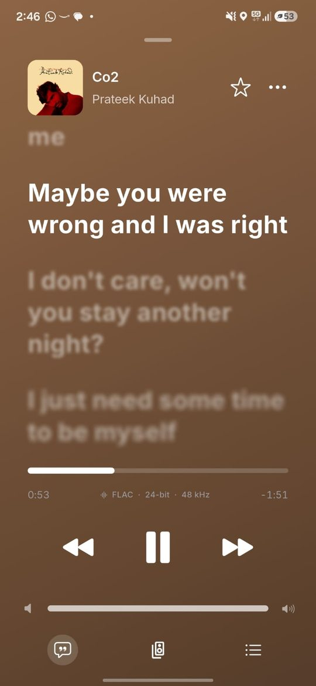
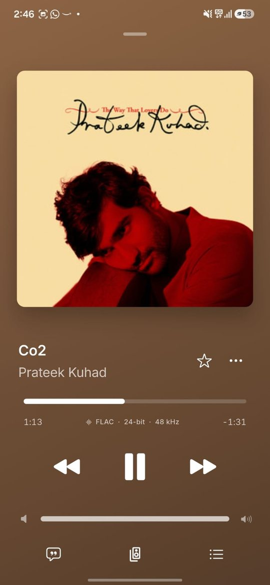
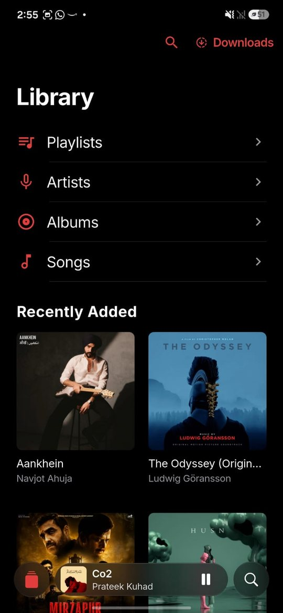
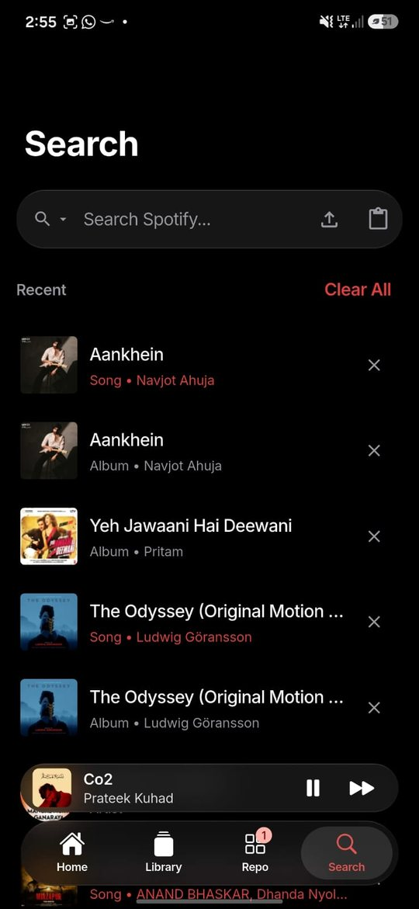
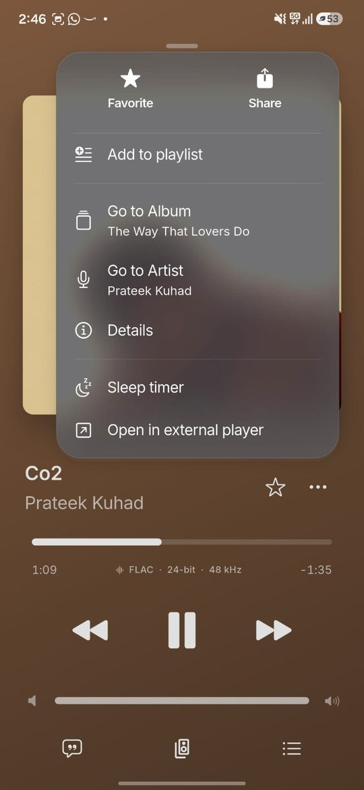
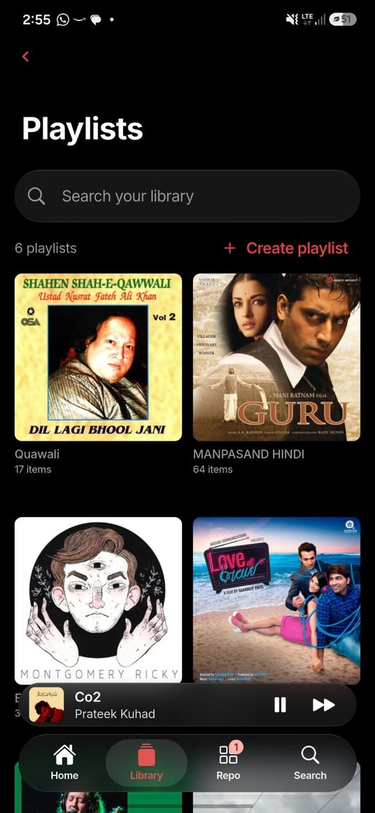
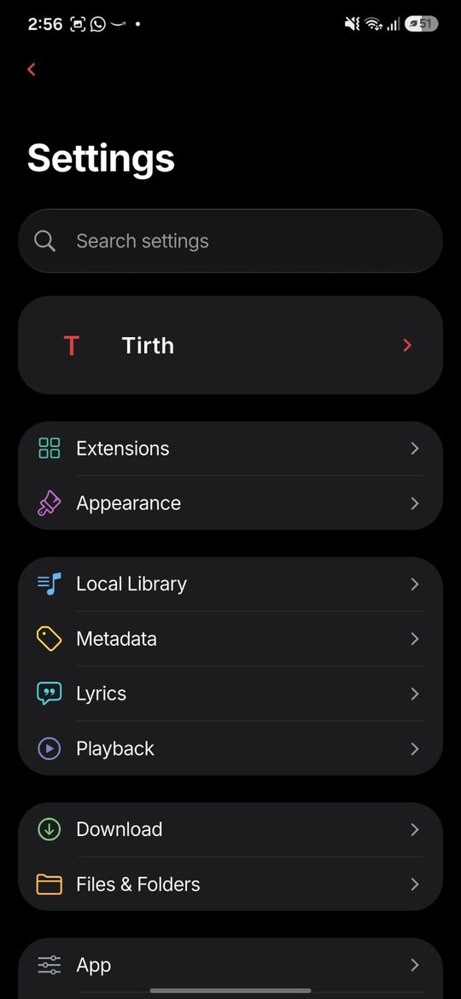

# 🎧 Hyde Music — By Tirth

A modern, fast and elegant music streaming app for Android, with a Liquid Glass interface, word-by-word lyrics and no ads.

**Latest: [Version 6.0.2](https://github.com/Hyde-OpenSource/Hyde-Music-Andorid/releases/latest)** · Also on [Windows & Linux](https://github.com/Hyde-OpenSource/Hyde-Music-Desktop) · [Website](https://www.hydeos.tech/music-docs.html) · [Changelog](CHANGELOG.md)

  
  
  
  

---

## ✨ What's new in 6.0

* ✨ **AI Shuffle**: a shuffle that flows from song to song and never gets stuck on one artist. It's in the player, the queue, every playlist and album, and the long-press menu.
* ➕ **Suggested Songs** under your playlists. Tap **+** to add one.
* 🔄 **Reload Home**: a reload button, and pull-to-refresh works now.
* 🌡️ **Runs cool**: 60 Hz by default, far fewer redraws and lighter images. If you want 90/120 Hz, switch on *Settings › Appearance › High refresh rate*.

Full notes: [CHANGELOG.md](CHANGELOG.md)

---

## 🎵 Features

* Stream unlimited music, ad-free
* Liquid Glass design, or a lighter *Performance* blur mode for older phones
* Word-by-word synced lyrics, translation and share cards
* Smart search with live suggestions
* Library: playlists, albums, artists, songs, downloads
* Offline downloads
* Sleep timer, playback speed and pitch, equalizer
* Cast / DLNA output, Listen Together
* In-app updates with checksum verification

  
  
  

---

## 📦 Installation

1. Open the [latest release](https://github.com/Hyde-OpenSource/Hyde-Music-Andorid/releases/latest).
2. Download the APK for your phone:
   * `HydeMusic-<version>-arm64-release.apk` for almost every phone made since 2017 (smaller download)
   * `HydeMusic-<version>-universal-release.apk` if you're not sure, or the arm64 one won't install
3. Open the file and allow *Install unknown apps* for your browser or file manager if Android asks.

Already on Hyde Music 5.x or 6.0? Install over it. Your library, playlists, downloads and settings are kept. 6.0 is signed with the same Hyde Open Source key as 5.5.

**Verify a download (optional):** compare `sha256sum <file>.apk` with `SHA256SUMS` in the release.

---

## 🔄 Updates

Hyde Music checks this repository for new releases. When one is out, you get a notification, and the update downloads, gets verified and installs from inside the app (*Settings › App › Software Update*).

---

## 🛠️ Tech Stack

* Flutter (Cupertino + Liquid Glass shaders, Impeller) for the interface
* Kotlin engine: Media3 / ExoPlayer playback, Room library, YouTube Music InnerTube client
* Riverpod state management

---

## ⚠️ Disclaimer

This application is intended for educational and personal use only.
All content is sourced from publicly available platforms.

---

## ❤️ Support

If you like this project, consider giving it a ⭐ on GitHub or [supporting development](https://www.hydeos.tech/donate.html).

~ Team Hyde · By Tirth and Hyde OpenSource
